# CleanDesk AI

CleanDesk is a portfolio demo of a booking assistant for a fictional cleaning company, **BrightHarbor Cleaning**. It is meant to show a client who already runs a Next.js and Postgres product that an AI agent can sit on top of their catalog: answer from company notes, price a visit with the same formula as the app, and call tools that refuse bad dates, unknown towns, and double-booked windows.

Live demo: https://cleandesk-ai.vercel.app (password `harbor-demo`). The public demo runs in mock mode with in-memory data that may reset.

The demo account password is `harbor-demo` unless `DEMO_PASSWORD` is set. Nothing in the dataset is a real person, address, or company.

## Features

- Service catalog with standard, deep, move-in/move-out, and office cleaning, plus oven, fridge, window, and carpet add-ons. Price is base + square feet + bedrooms + bathrooms + add-ons.
- Bookings list with confirmed, rescheduled, and cancelled filters, and a detail page.
- Chat assistant, full page and a docked widget. Answers about services, prices, towns, and the cancellation policy include source chips from the knowledge notes.
- Tools: `get_quote`, `check_availability`, `create_booking`, `reschedule_booking`. Arguments are checked with Zod. Past dates, postal codes outside Harborlight, short windows, and slots that already have an active booking are rejected.
- Create and reschedule do not write. They return a confirmation card. The visit changes only after **Confirm**.
- Every tool call is stored in `chat_logs` and shown on the Activity page.
- `LLM_PROVIDER=mock` works with no API key. `qwen` uses Alibaba Cloud Model Studio (DashScope) in the Singapore region.
- Supabase Postgres + pgvector when both Supabase env vars are set. Otherwise the same seed data lives in memory for the life of the server process.

## Architecture

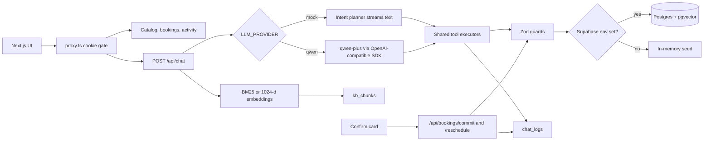

The browser never sees the Supabase service role key or the DashScope key. Route handlers and server components are the only callers.

## How the agent and tool guards work

1. The latest user message is retrieved against `kb_chunks`. Mock mode uses BM25 over the note text. Qwen mode embeds the question with `text-embedding-v3` (1024 dimensions) and asks Postgres for the nearest chunks. If the key, the vector, or the RPC is missing, retrieval falls back to the same keyword search.
2. Retrieved notes are passed to the model as instructions and rendered in the transcript as citation chips (`cancellation-policy`, `pricing-guide`, and so on).
3. Read tools run immediately:
   - `get_quote` uses the catalog formula in `src/lib/pricing.ts`.
   - `check_availability` returns open Monday–Saturday windows (8:00–1:00 or 1:00–6:00 America/Los_Angeles) inside the requested town.
4. Write tools only **propose**. `create_booking` and `reschedule_booking` validate and return a card. The system prompt tells the model not to claim the visit is saved.
5. Guards in `src/lib/guards.ts` are Zod schemas plus refinements:
   - dates and slot start times cannot be in the past
   - the postal code must belong to Port Meridian, Cedarwharf, Northglass, or Millhaven
   - the slot must exist, still be open, and have no other confirmed or rescheduled booking
   - the window must be long enough for the service
   - a cancelled booking cannot be moved
6. Confirm calls `/api/bookings/commit` or `/api/bookings/reschedule`, which run the same guards again and then write. A second click on a taken window gets a conflict instead of a double booking.
7. Proposals, reads, commits, and rejections are inserted into `chat_logs`.

Mock mode does not call a model. A small intent parser (`src/lib/agent/mock-plan.ts`) chooses the same executors and streams the reply token by token so the transcript still feels like chat. Switching providers does not change the tools or the confirm step.

## Mock and Qwen

| | Mock (default) | Qwen |
| --- | --- | --- |
| Env | `LLM_PROVIDER=mock` or unset | `LLM_PROVIDER=qwen` |
| Key | none | `DASHSCOPE_API_KEY` |
| Endpoint | none | `DASHSCOPE_BASE_URL` default `https://dashscope-intl.aliyuncs.com/compatible-mode/v1` |
| Chat model | rules in `src/lib/agent/mock-plan.ts` | `qwen-plus` (`DASHSCOPE_CHAT_MODEL`) |
| Retrieval | BM25 | `text-embedding-v3`, 1024 dimensions, then BM25 if embeddings are unavailable |
| Tools | shared executors | AI SDK `streamText` tool calls, same executors |

Qwen is wired with `@ai-sdk/openai-compatible` (`createOpenAICompatible`), not a DashScope-only SDK, because Model Studio's international endpoint speaks the OpenAI chat and embeddings APIs. The pgvector column is `extensions.vector(1024)` to match `text-embedding-v3`'s default size. `npm run ingest:embeddings` refuses vectors of any other length.

## Local setup

```bash
npm install
npm test
npm run dev
```

Open http://localhost:3000 and sign in with `harbor-demo`.

Useful checks:

```bash
npm run lint
npm run build
```

No `.env` file is required for the mock demo. Copy `.env.example` to `.env.local` only when you want Qwen or Supabase.

In-memory data resets when the Node process stops. That is expected on Vercel unless Supabase is configured.

## Supabase

1. Create a project.
2. In the SQL editor, run `supabase/migrations/20261106180000_init.sql`. It enables `vector`, creates the tables, turns on row level security, and revokes Data API access from `anon` and `authenticated`. The app uses the service role from the server only, so there are no public policies.
3. Set:

```bash
NEXT_PUBLIC_SUPABASE_URL=https://YOUR_PROJECT.supabase.co
SUPABASE_SERVICE_ROLE_KEY=YOUR_SERVICE_ROLE_KEY
```

4. Load the fictional seed (about three weeks of slots and 20 bookings):

```bash
npm run seed
```

5. For Qwen retrieval, after `DASHSCOPE_API_KEY` is set:

```bash
npm run ingest:embeddings
```

That writes `data/embeddings.json` (gitignored) and, when Supabase is configured, fills `kb_chunks.embedding`. If this step is skipped, search stays on keywords.

If only one of the two Supabase variables is set, the server throws instead of silently mixing modes.

## Vercel

Do not put secrets in the repo. In the project settings, add:

- `LLM_PROVIDER` — `mock` or `qwen`
- `DASHSCOPE_API_KEY` — only for qwen
- `DASHSCOPE_BASE_URL` — `https://dashscope-intl.aliyuncs.com/compatible-mode/v1`
- `DASHSCOPE_CHAT_MODEL` — `qwen-plus`
- `DASHSCOPE_EMBEDDING_MODEL` — `text-embedding-v3`
- `NEXT_PUBLIC_SUPABASE_URL`
- `SUPABASE_SERVICE_ROLE_KEY`
- `DEMO_PASSWORD` — change this before sharing a public URL

Framework preset is Next.js. `npm run build` is the build command. No extra output directory. The chat route sets `maxDuration` to 60 seconds so a Qwen tool loop can finish. After deploy, run the SQL migration and `npm run seed` from a machine that has the service role key. Paste the deployment URL into the live-demo line at the top of this file.

## Screenshots

Login gate. The password is on the card so a reviewer can enter.

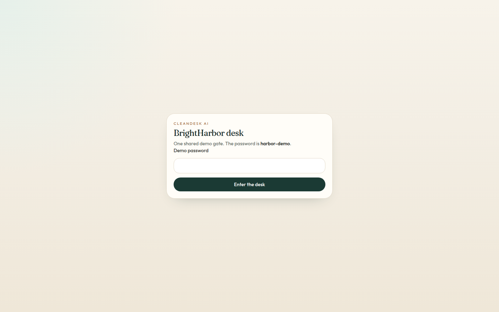

Catalog. The same numbers feed `get_quote`.

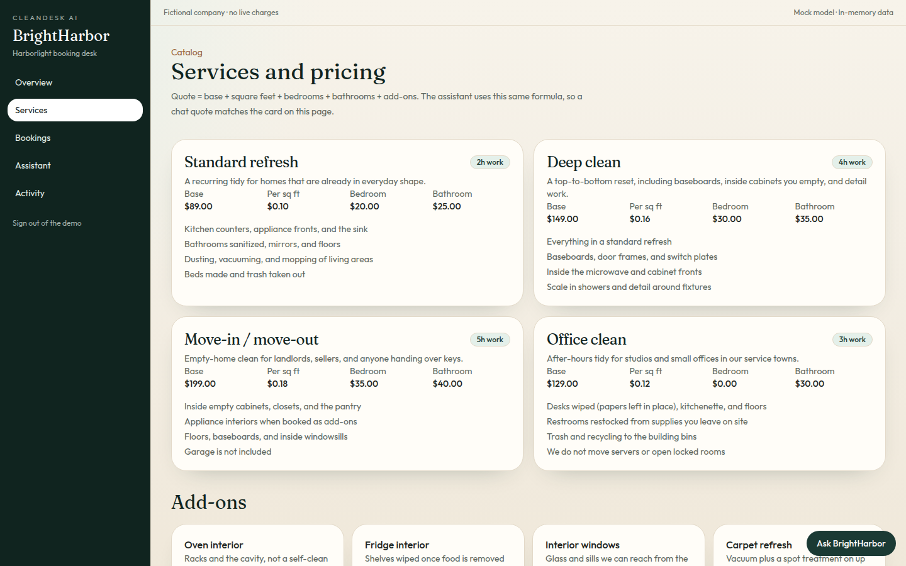

Bookings with status filters.

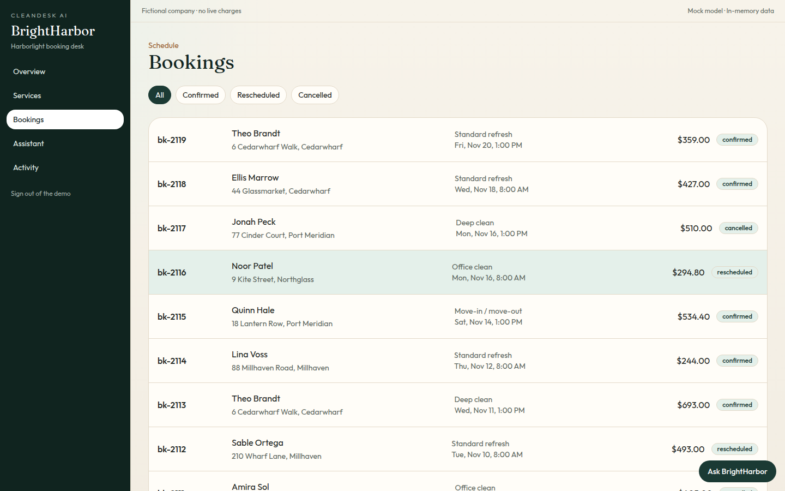

A single visit.

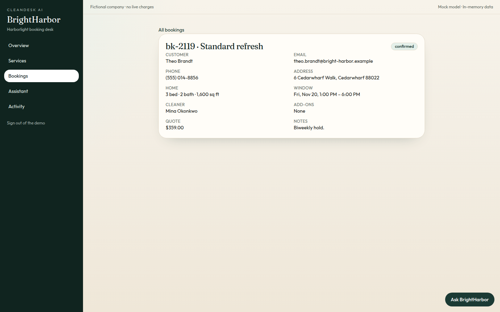

Desk overview.

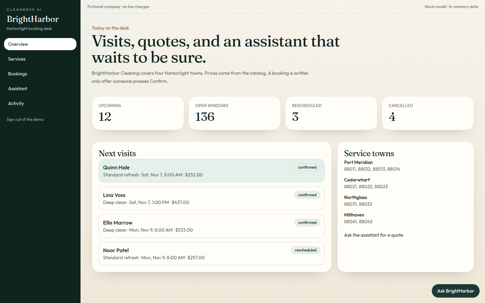

Cancellation policy, with the note cited under the answer.

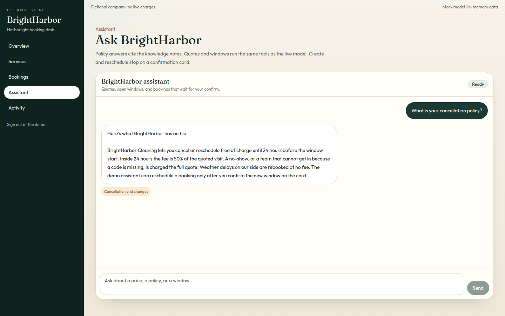

A deep-clean quote for 1,100 sq ft, 2 bed, 2 bath, plus the oven add-on ($504.00).

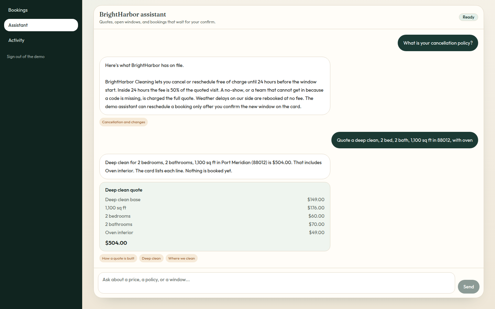

The booking is not saved until Confirm.

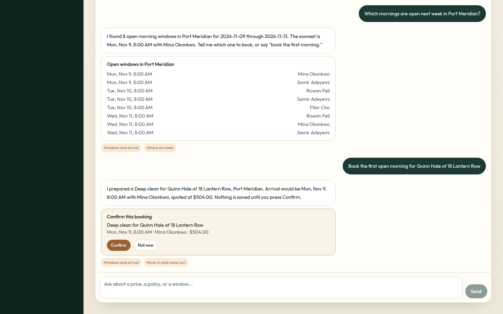

After Confirm, and a reschedule onto the following afternoon, the visit is first on the list.

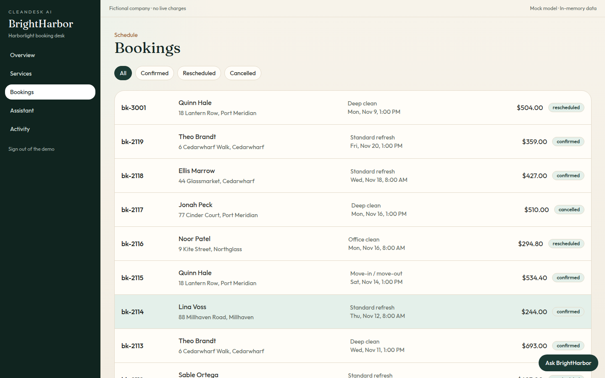

Tool calls landed in `chat_logs`.

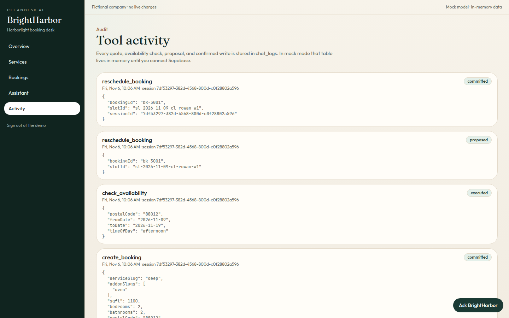

## Project map

- `src/app/(desk)` — catalog, bookings, assistant, activity
- `src/app/api/chat/route.ts` — mock stream or Qwen `streamText`
- `src/lib/guards.ts`, `src/lib/pricing.ts`, `src/lib/booking.ts` — rules under test
- `src/lib/store` — memory or Supabase
- `supabase/migrations` — schema
- `scripts/seed.ts`, `scripts/ingest-embeddings.ts`
- `tests` — quote math, guard rejections, BM25, and the mock book/reschedule path
